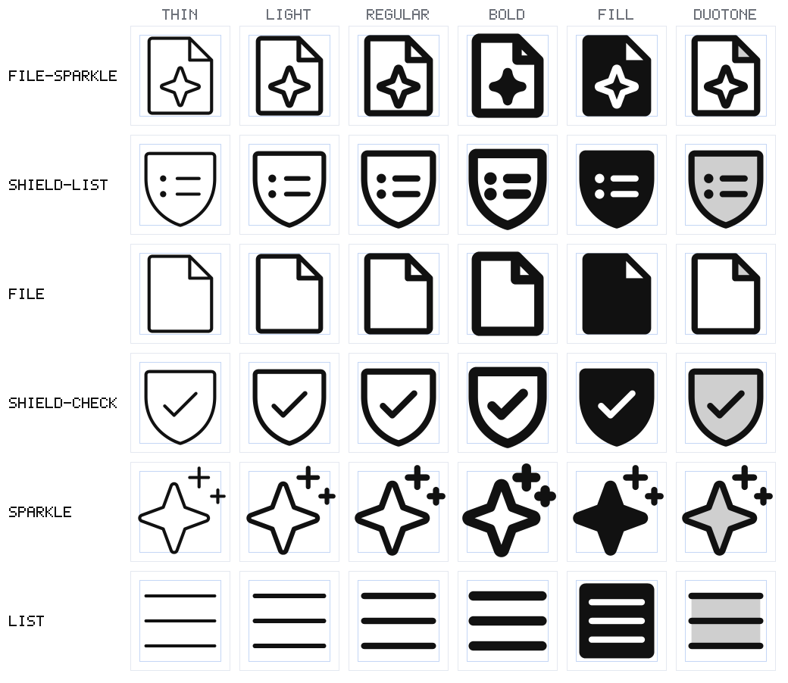
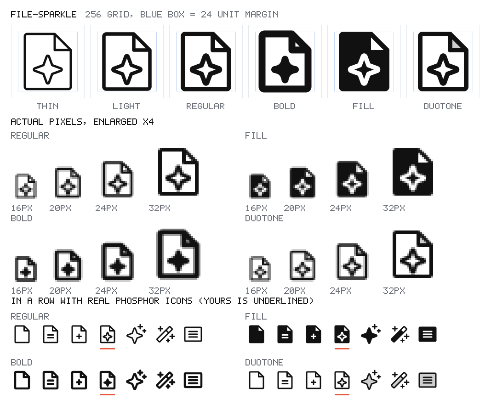

<h1 align="center">IconKit</h1>

<p align="center">
  A Claude Code skill that designs new icons in the Phosphor style and builds
  them in all six weights — thin, light, regular, bold, fill and duotone — as
  production SVG, from a description of the feature.
</p>

<p align="center">
  
</p>

<p align="center">
  <sub>The top two rows don't exist in Phosphor. The bottom four do.<br>
  Same grid, same strokes, same six weights, same file format.</sub>
</p>

---

## What it does

Phosphor has 1,512 icons. Your product has a feature it doesn't cover.

You say:

> Make an icon for AI-generated documents. Phosphor doesn't have one.

You get `file-sparkle`: six SVGs named and formatted the way Phosphor ships its
own, a preview that puts the new icon in a row with real ones, and, if you ask,
a React component that takes `weight`, `size` and `color` like any built-in
Phosphor icon.

> **Draw one skeleton. Let the build make the weights. Then look at it.**

The model writes a single small SVG of centrelines. A script strokes it at
Phosphor's four widths, builds the fill and duotone from roles marked in the
source, expands everything to clean outlined paths, and checks the result
against rules measured from all 1,512 Phosphor icons. Nobody writes a weight by
hand.

## Install

**Claude Code**

```bash
git clone https://github.com/Devesh-Shirsath/IconKit.git \
  ~/.claude/skills/iconkit
```

Restart Claude Code and just ask. The skill picks itself up whenever you need
an icon Phosphor doesn't have, describe a feature that wants an icon, or ask
for the bold, fill or duotone version of one.

**Codex**

```bash
git clone https://github.com/Devesh-Shirsath/IconKit.git \
  ~/.agents/skills/iconkit
```

Restart Codex, then ask — or call it by name: `$iconkit an icon for rate limits`.

**Any other agent that can run Python** — clone the repo into your project and
ask it to follow `SKILL.md`. `AGENTS.md` tells it what to read and what to skip.

**Claude.ai** — Settings → Capabilities → Skills → upload a zip of this repo.
Code execution has to be on, because the six weights come from a script.
Re-upload whenever the repo changes.

No dependencies. Python 3.8+, standard library only — nothing to `pip install`.

## Try it without an agent

```bash
python3 scripts/iconkit.py find audit log history record
```

searches Phosphor's names by idea, best match first. And

```bash
python3 scripts/iconkit.py build showcase/file-sparkle/file-sparkle.source.svg \
  --near file,file-text,file-plus,sparkle,magic-wand,article -o /tmp/file-sparkle
```

rebuilds one of the showcase icons from its skeleton: six SVGs and a
`preview.png`.

## Why a skeleton and not six drawings

Phosphor's four stroke weights are one drawing stroked at four widths. Fill and
duotone are that same drawing plus a decision about which body goes solid and
which gets the tint. Draw six files by hand — or ask a model to — and you get
six icons that almost match. Build six from one source and you get one icon in
six weights.

This is not approximate. The 44 sources in `assets/examples/` are real Phosphor
icons rebuilt this way. `scripts/selftest.py` rebuilds every one and compares
each weight with the original's outline, and all 44 pass.

## How it works

```
your feature description
      ↓
what does it do?                      the thing, and what happens to it
      ↓
does Phosphor already have it?        iconkit.py find
      ↓
choose the picture                    an object · an object + one modifier · a small diagram
      ↓
one skeleton of centrelines           started from the nearest real icon, not a blank file
      ↓
decide fill and duotone               what goes solid, what is knocked out, what gets the tint
      ↓
build                                 six outlined SVGs + preview.png
      ↓
look at the preview, fix the source, rebuild
```

### Six weights from one source

On a 256 × 256 canvas:

| Weight  | How it is made                                              | At 16 px |
|---------|-------------------------------------------------------------|----------|
| thin    | the skeleton, stroked at 8                                  | 0.5 px   |
| light   | stroked at 12                                               | 0.75 px  |
| regular | stroked at 16                                               | 1 px     |
| bold    | stroked at 24                                               | 1.5 px   |
| fill    | stroked at 16, bodies solid, details knocked out            |          |
| duotone | stroked at 16, plus a 20% tint layer                        |          |

### The source

An ordinary SVG that renders as the regular weight in any viewer. A handful of
`data-` attributes say what an element becomes in the designed weights. This is
the whole of `shield-list`:

```svg
<svg xmlns="http://www.w3.org/2000/svg" viewBox="0 0 256 256" fill="none" stroke="currentColor" stroke-width="16" stroke-linecap="round" stroke-linejoin="round">
  <!-- security: Phosphor's shield, unchanged -->
  <path d="M216,112V56a8,8,0,0,0-8-8H48a8,8,0,0,0-8,8v56c0,96,88,120,88,120S216,208,216,112Z" data-fill="solid" data-duotone="tint"/>
  <!-- the group of rules: two rows, each a condition marker and its rule -->
  <g data-fill="knockout">
    <circle cx="84" cy="112" r="4" fill="currentColor"/>
    <line x1="120" y1="112" x2="176" y2="112" data-not="bold"/>
    <line x1="128" y1="112" x2="176" y2="112" data-only="bold"/>  <!-- bold: clear of the dot -->
    <circle cx="84" cy="152" r="4" fill="currentColor"/>
    <line x1="120" y1="152" x2="176" y2="152" data-not="bold"/>
    <line x1="128" y1="152" x2="176" y2="152" data-only="bold"/>  <!-- bold: clear of the dot -->
  </g>
</svg>
```

`SPEC.md` has the full format: every role, the keyline shapes, the standard
glyphs, the slash recipe and the naming rules.

## The preview

<p align="center">
  
</p>

Every build writes one, laid out so each question has an answer at a glance.

- **Top** — six weights, large, with the 24-unit margin drawn. Is it the thing
  you meant? Does it fill the box?
- **Middle** — real pixels at 16, 20, 24 and 32, enlarged. Which detail has
  turned to mush?
- **Bottom** — yours, underlined, in a row of real Phosphor icons. Cover the
  underline. If you can pick yours out, that is the thing to fix. It should be
  boring in this row.

## What the checker enforces

`iconkit.py build` and `check` report three levels.

- **error** — bold leaves the canvas · the fill weight has nothing solid ·
  duotone has no tint · a knockout is painted over by a later solid · a weight
  is empty · the viewBox is wrong.
- **warn** — ink past 8..248 · long side under 176 · more than 12 off centre ·
  an opening under 16 (12 in bold) · a counter that closes or parts that merge
  in bold · more than 9 elements · a name that collides with Phosphor's.
- **note** — ink past 16..240 · ink coverage outside 10–27% · fill barely
  heavier than regular · many off-grid coordinates.

A clean check means the icon obeys the measurable rules. It does not mean the
icon is good. Only looking at the preview tells you that.

## What you get

```
icons/file-sparkle/
  file-sparkle.source.svg     the skeleton — the only file you edit
  file-sparkle.svg            regular
  file-sparkle-thin.svg
  file-sparkle-light.svg
  file-sparkle-bold.svg
  file-sparkle-fill.svg
  file-sparkle-duotone.svg
  preview.png
  FileSparkle.tsx             with --react
```

Each SVG is a single outlined path with `fill="currentColor"`, and duotone
carries its tint path at `opacity="0.2"` first — Phosphor's own format and
naming. `--react` writes a component for `@phosphor-icons/react`:

```tsx
<FileSparkle weight="duotone" size={24} color="currentColor" />
```

Two finished icons are in `showcase/`.

## Adding icons to Figma

After delivering, the skill asks whether you want the icon added to your Figma
icon library as components, and which file. It does nothing in Figma until you
answer both. Then it reads how that file already builds its icons — a component
set or separate components, how weights are named, the size, the colour style —
and matches it, in a section of its own.

It works through Figma's own MCP server or a console/bridge server, whichever
the session has.

## The tools

```bash
python3 scripts/iconkit.py find <words…>                       # search Phosphor's names by idea
python3 scripts/iconkit.py sheet <names|sources…> -o out.png   # six-weight contact sheet
python3 scripts/iconkit.py show <name> [weight]                # a real icon's path data and ink box
python3 scripts/iconkit.py build <source> [--near a,b,c,d,e,f] [--react] [-o dir]
python3 scripts/iconkit.py check <source>                      # the checker alone
python3 scripts/iconkit.py compare <source> <name>             # how far a source is from a real icon
python3 scripts/selftest.py                                    # after changing the scripts
```

`sheet` takes source files as well as Phosphor names, so a draft can sit on the
same sheet as the icons it should match. The image at the top of this page is
one command.

## What's in the box

```
SKILL.md                  entry point and workflow
SPEC.md                   every number: grid, strokes, source format, standard parts — start here
AGENTS.md                 what an AI agent should read, and skip
references/
  concept.md              from a feature to a drawing, with worked examples
  examples.md             the 44 example sources, by what they teach
  weights.md              designing fill, duotone and bold; diagnosing a bad preview
  figma.md                adding finished icons to a Figma library
scripts/
  iconkit.py              find · sheet · show · build · check · compare
  outline.py              strokes and shapes to outlined paths
  raster.py               the preview renderer
  svgpath.py              SVG path parsing
  selftest.py             rebuilds every example against the real icon
assets/
  examples/               44 real Phosphor icons as skeleton sources
  phosphor.json.gz        Phosphor's paths, for search and comparison
  PHOSPHOR-LICENSE
showcase/                 two icons made with IconKit, and the sheet above
```

## Known limitations

- **Bold wants a second look.** Phosphor hand-tunes bold in roughly a third of
  its icons. The checker reports openings that close; the fix is a judgement,
  written as an alternate for that one weight.
- **A clean check is not a good icon.** The measurable rules are enforced.
  Whether a stranger would name it is not.
- **Hand-tuned fills are not reproduced.** Where Phosphor goes beyond the simple
  rule (`house`, `cloud`, `globe`, `key`), the examples keep the simple version.
- **The Phosphor index is a snapshot.** It comes from `@phosphor-icons/react`
  2.1.10, so icons added to Phosphor later won't appear in `find`.
- **Figma needs a connection.** Without a Figma MCP or bridge server the skill
  stops at the SVGs.

## Who it's for

Product and UX designers, design system teams and frontend developers who use
Phosphor and keep running into the icon it doesn't have — and don't want the
replacement to look like it came from somewhere else.

## Author

IconKit was built by **[Devesh Shirsath](https://deveshshirsath.com)**, a product
designer working on developer tools and API documentation. It is a sibling of
**[Spotkit](https://github.com/Devesh-Shirsath/spotkit)**, which does the same
job for product illustrations.

[Portfolio](https://deveshshirsath.com) ·
[LinkedIn](https://www.linkedin.com/in/devesh-shirsath-644625172/) ·
[GitHub](https://github.com/Devesh-Shirsath) ·
[Instagram](https://www.instagram.com/devesh.vs/)

## Credits

Built on [Phosphor Icons](https://phosphoricons.com) by Helena Zhang and Tobias
Fried (MIT). `assets/phosphor.json.gz` holds path data from
`@phosphor-icons/react` 2.1.10, and the 44 sources in `assets/examples/` are
Phosphor icons rebuilt as skeletons. Both stay under Phosphor's licence, which
is included as `assets/PHOSPHOR-LICENSE`.

IconKit is an independent project. It is not affiliated with or endorsed by
Phosphor Icons.

MIT licensed. Contributions welcome, especially new example sources and bold
alternates.
